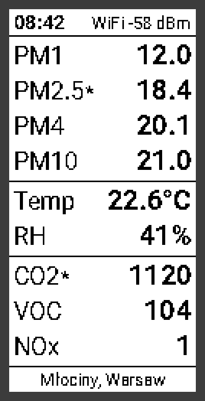

# ESPHome Air Quality Sensor

An indoor air quality monitor built from an ESP32, a Sensirion SEN66 sensor and a 2.13" e-paper display, running [ESPHome](https://esphome.io).



- Shows nine readings from the SEN66: PM1, PM2.5, PM4, PM10, temperature, humidity, CO2, VOC index and NOx index
- Flags readings outside healthy ranges with `*`, `**` or `***` next to the label
- Clock and WiFi signal in the header, location in the footer
- Redraws on the minute, with partial refresh so the e-paper does not flash every time
- Sends every reading to [Home Assistant](https://www.home-assistant.io) every 10 seconds
- Keeps working without WiFi (readings still update) and without the sensor (values show dashes)
- Updates over WiFi (encrypted OTA) after the first USB flash

The image is a rendered preview with sample values, drawn with the same fonts and coordinates as the firmware.

<br clear="right">

## Hardware

| Part | Notes |
|-|-|
| ESP32 DevKit (ESP32-WROOM-32, 30-pin) | ESPHome board `esp32dev` |
| Waveshare 2.13" e-Paper HAT V4, black/white, 250x122 | Rev 2.1 driver board, comes with an 8-wire cable |
| Sensirion SEN66 on the Adafruit SEN6x breakout | I2C address `0x6B` |
| STEMMA QT (JST SH 4-pin) to jumper cable | Connects the SEN66 breakout to the ESP32 |

## Wiring

### Display (SPI)

| Display pin | ESP32 GPIO |
|-|-|
| VCC | 3V3 |
| GND | GND |
| DIN (MOSI) | GPIO23 |
| CLK (SCK) | GPIO18 |
| CS | GPIO5 |
| DC | GPIO17 |
| RST | GPIO16 |
| BUSY | GPIO4 |

If the HAT has an interface switch or BS jumper on the back, leave it on 0 (4-line SPI).

### SEN66 (I2C)

| STEMMA QT wire | ESP32 GPIO |
|-|-|
| Red (VIN) | 3V3 |
| Black (GND) | GND |
| Blue (SDA) | GPIO21 |
| Yellow (SCL) | GPIO22 |

The I2C bus runs at 100 kHz, which is what the SEN66 supports.

## Setup

### 1. Install ESPHome

ESPHome needs Python 3.12 or newer. Ubuntu 22.04 ships 3.10, so this project uses [uv](https://docs.astral.sh/uv/) to get a newer Python inside a virtual environment:

```bash
git clone https://github.com/aravindsairam/esphome-air-sensor.git
cd esphome-air-sensor
uv venv -p 3.12
uv pip install esphome
```

`uv venv` creates `.venv` in the project folder and `uv pip install` installs into it. If your system Python is already 3.12 or newer, `python3 -m venv .venv` followed by `.venv/bin/pip install esphome` works too.

### 2. Add your secrets

```bash
cp secrets.example.yaml secrets.yaml
openssl rand -base64 32
```

Paste the random string from `openssl` as `api_key`, then fill in your WiFi name and password and a hotspot password. Note that the ESP32 only connects to 2.4 GHz WiFi.

### 3. Set your location

Change the `location` substitution at the top of [air-sensor.yaml](air-sensor.yaml). It is printed at the bottom of the screen, so keep it under about 20 characters. Also change `timezone:` under `time:` if you are not in Europe/Warsaw.

### 4. First flash over USB

```bash
.venv/bin/esphome run air-sensor.yaml
```

ESPHome compiles the firmware and then asks where to upload it. Pick the USB serial port (usually `/dev/ttyUSB0`).

The first build downloads the ESP-IDF toolchain and the Roboto font from Google Fonts, so it needs internet and takes a while. If the board does not start flashing, hold the BOOT button while it says `Connecting...`.

### 5. Later updates over WiFi

Once the device is on your network, run the same command and pick the Over The Air option instead of the serial port. To watch the logs:

```bash
.venv/bin/esphome logs air-sensor.yaml
```

OTA updates are encrypted with the same `api_key` as the Home Assistant API.

## The display

The screen is used in portrait (122x250) and split into groups:

| Section | Contents |
|-|-|
| Header | Clock (HH:MM) and WiFi signal in dBm, or `No WiFi` |
| Particles | PM1, PM2.5, PM4, PM10 in µg/m³ |
| Climate | Temperature in °C and relative humidity in % |
| Gases | CO2 in ppm, VOC index, NOx index |
| Footer | Location |

Refresh behaviour:

- Redraws every minute, exactly on the minute, once the clock is set from the internet (SNTP)
- Without WiFi the clock is never set, so it redraws every 60 seconds instead
- Uses partial refresh, with a full refresh every 30 updates (about every 30 minutes) to clear ghosting
- A value shows dashes while the sensor is missing, warming up, or a read failed

### Warning stars

A reading gets one, two or three stars next to its label as it moves further from a healthy range. All limits live in the display lambda in [air-sensor.yaml](air-sensor.yaml) and are easy to change.

| Reading | `*` | `**` | `***` | Source |
|-|-|-|-|-|
| PM2.5 (µg/m³) | ≥ 15 | ≥ 50 | ≥ 75 | WHO 24-hour guideline, interim targets 2 and 1 |
| PM10 (µg/m³) | ≥ 45 | ≥ 100 | ≥ 150 | WHO 24-hour guideline, interim targets 2 and 1 |
| CO2 (ppm) | ≥ 1000 | ≥ 1500 | ≥ 2000 | German Environment Agency (UBA) |
| VOC index | ≥ 150 | ≥ 250 | ≥ 400 | Rule of thumb (100 = normal for the room) |
| NOx index | ≥ 20 | ≥ 150 | ≥ 300 | Rule of thumb (1 = normal for the room) |
| Temperature (°C) | outside 19 to 25 | outside 17 to 27 | outside 15 to 30 | Comfort range |
| Humidity (%) | outside 35 to 60 | outside 30 to 70 | outside 20 to 80 | Comfort range, mould risk above 70 |

PM1 and PM4 have no official limits, so they never get stars.

## Home Assistant

The device uses the native ESPHome API with encryption. Home Assistant discovers it automatically; enter the `api_key` from `secrets.yaml` when asked. These entities appear:

- PM1.0, PM2.5, PM4.0, PM10
- Temperature, Humidity
- CO2, VOC Index, NOx Index
- WiFi Signal (diagnostic)

## WiFi fallback

If the device cannot join your WiFi, it opens a hotspot called `air-sensor Fallback` (password: `ap_password` from `secrets.yaml`). Connect to it and a captive portal lets you enter new WiFi details.

## Troubleshooting

| Problem | Fix |
|-|-|
| `/dev/ttyUSB0` never appears on Ubuntu | The `brltty` braille service grabs CH340 USB serial chips. Run `sudo systemctl mask brltty-udev.service brltty.service`, then replug the board. Also make sure you are in the `dialout` group. |
| Screen stays blank or shows garbage | Change `model:` under `display:` to `2.13inv2`, then `2.13in`, one at a time |
| Image is upside down | Set `rotation: 180` under `display:` |
| All sensor values show dashes | The SEN66 was not found at boot. Check the wiring, then power-cycle the ESP32. |
| Some values show dashes right after boot | The SEN66 is warming up: PM, temperature and humidity take about a minute, CO2 a few minutes, VOC and NOx up to an hour |
| Log says `OTA rollback detected` | New firmware is only marked good after 60 seconds of uptime. Do not reset the board (EN button, or a logs command that resets it) within 60 seconds of an OTA update. |
| Build fails while fetching fonts | The first build needs internet for Google Fonts. Offline, put a TTF in `fonts/` and use `file: "fonts/Roboto-Bold.ttf"` instead of `gfonts://`. |

## Alternative layout

[air-sensor.landscape.yaml.bak](air-sensor.landscape.yaml.bak) is an older landscape (250x122) layout: large PM2.5 and CO2 values on the left, VOC, NOx, temperature and humidity on the right, and location, clock and WiFi in the footer. It has no warning stars. To use it, copy it over `air-sensor.yaml` and flash as usual.

## Project files

| File | Purpose |
|-|-|
| [air-sensor.yaml](air-sensor.yaml) | ESPHome configuration: WiFi, sensor, display and layout |
| [secrets.example.yaml](secrets.example.yaml) | Template for `secrets.yaml` (which is git-ignored) |
| [air-sensor.landscape.yaml.bak](air-sensor.landscape.yaml.bak) | Older landscape layout |
| [docs/display-preview.png](docs/display-preview.png) | Rendered preview of the screen |
| [.vscode/settings.json](.vscode/settings.json) | Teaches the VS Code YAML extension about ESPHome tags like `!secret` |

Built and tested with ESPHome 2026.10.0.
